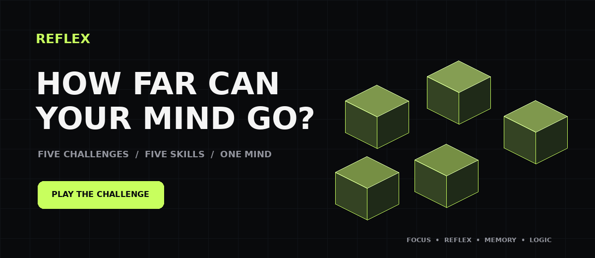
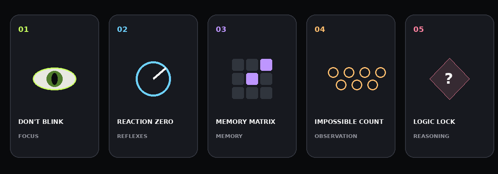

<div align="center">



# REFLEX
### HOW FAR CAN YOUR MIND GO?

**FIVE CHALLENGES · FIVE SKILLS · ONE MIND**

[▶ PLAY REFLEX](REPLACE_WITH_YOUR_LIVE_URL) · [EXPLORE THE GAMES](#the-five-challenges) · [GET STARTED](#getting-started)


</div>

---

## THE EXPERIENCE

REFLEX is a browser-based challenge arcade built around five different skills: focus, reaction speed, memory, observation and logical reasoning.

Each challenge has its own rules, pace and scoring system. Play a quick round, discover where you excel, then try again to beat your personal best.

- **Instant play** — no account or installation.
- **Five distinct challenges** — five different mechanics.
- **Personal progress** — scores are saved in your browser.
- **Responsive interface** — designed for desktop and mobile.
- **Lightweight build** — the core experience runs in a single HTML file.

> **The objective:** improve your own performance, one attempt at a time.

## THE FIVE CHALLENGES

<div align="center">

</div>

| # | Challenge | Skill | Objective |
|---|---|---|---|
| 01 | **DON'T BLINK** | Focus | Hold your stare for 30, 60 or 90 seconds. |
| 02 | **REACTION ZERO** | Reflexes | React to the green signal across five rounds. |
| 03 | **MEMORY MATRIX** | Memory | Repeat a growing sequence of illuminated tiles. |
| 04 | **IMPOSSIBLE COUNT** | Observation | Count a target shape among moving distractions. |
| 05 | **LOGIC LOCK** | Reasoning | Complete generated number and symbol patterns. |

### 01 — DON'T BLINK
Choose a 30, 60 or 90-second session. Keep your eyes open and use the blink button or Space key to report a blink. A Hindi detective-style voice-over is used on the loss screen when browser speech support is available.

### 02 — REACTION ZERO
Five rounds begin after a random wait. Tap only when the screen turns green. An early tap is a false start. Your session tracks reaction times, average and best response.

### 03 — MEMORY MATRIX
Memorize a sequence of illuminated tiles and reproduce it in the same order. The sequence grows as you advance, with the grid progressing from 3×3 to 4×4 and then 5×5. You have three lives.

### 04 — IMPOSSIBLE COUNT
Count one requested geometric shape among moving and rotating distractions. Eight rounds increase the challenge, and faster correct answers can earn a larger bonus.

### 05 — LOGIC LOCK
Solve generated number and symbol patterns. Select the missing value from four choices before the countdown ends. Correct answers build a streak and earn time bonuses.

## SCORING SYSTEM

| Challenge | Scoring |
|---|---|
| Don't Blink | 10 points per second survived, plus a completion bonus |
| Reaction Zero | Up to 1,000 points per successful round, reduced by reaction time |
| Memory Matrix | 100 × cleared level |
| Impossible Count | 100 points per correct answer, plus a time bonus |
| Logic Lock | 100 points per correct answer, plus time and streak bonuses |

### PERFORMANCE RATINGS

| Rating | Score percentage |
|---|---:|
| Keep Training | Below 40% |
| Sharp | 40–69% |
| Elite | 70–89% |
| Legendary | 90–100% |

## YOUR PERSONAL DASHBOARD

REFLEX tracks total games played, best reaction time, highest Memory Matrix level, overall answer accuracy, personal bests and the eight most recent results.

### LOCAL DATA & PRIVACY

Statistics are stored in browser `localStorage`. No account is needed and the core project does not send player statistics to a server. Records are tied to the browser profile; clearing browser storage can erase them.

## VISUAL IDENTITY

REFLEX uses a dark, high-contrast interface with a restrained acid-green accent.

| Token | Value |
|---|---|
| Background | `#090A0C` |
| Secondary | `#111318` |
| Cards | `#17191F` |
| Primary text | `#F5F5F5` |
| Secondary text | `#92949D` |
| Accent | `#C8FF5E` |

**Design principles:** clear hierarchy, balanced spacing, readable typography, subtle motion, responsive controls and minimal visual noise.

## BUILT WITH

| Technology | Purpose |
|---|---|
| HTML5 | Structure |
| CSS3 | Layout, styling and transitions |
| JavaScript | Game mechanics and scoring |
| Canvas API | Geometric rendering |
| Web Audio API | Synthesized sound effects |
| Web Speech API | Optional Hindi voice-over |
| LocalStorage | Local player statistics |

The core application is dependency-free. It does not require a frontend framework, package installation or backend service.

## GETTING STARTED

### Requirements
- A modern web browser
- Python 3 (optional, for local HTTP serving)

### 1. Clone the repository

```bash
git clone https://github.com/YOUR-USERNAME/REFLEX.git
```

### 2. Enter the project directory

```bash
cd REFLEX
```

### 3. Start a local server

```bash
python -m http.server 8080
```

### 4. Open the game

Visit `http://localhost:8080`.

You can also open `index.html` directly. No `npm install` or build command is required for the single-file version.

## PROJECT STRUCTURE

```text
REFLEX/
├── assets/
│   ├── reflex-hero.gif
│   └── reflex-games.png
├── index.html
├── README.md
└── LICENSE
```

Keep the two artwork files in `assets/` with these exact names. GitHub displays them using the relative paths in this README.

## BROWSER SUPPORT & NOTES

- Core gameplay requires a modern browser with JavaScript enabled.
- Sound effects use Web Audio API and start after user interaction.
- Hindi voice-over depends on Web Speech API and available system voices.
- Local records require browser storage to be enabled.
- **Don't Blink is manual in this version.** It does not use webcam-based automatic blink detection.
- The current project does not include accounts, cloud saves or a global leaderboard.

## ROADMAP

- [ ] Optional webcam-based blink detection with explicit camera permission
- [ ] Daily challenge mode
- [ ] Global leaderboard
- [ ] Achievement and badge system
- [ ] More challenge types and difficulty modes
- [ ] Expanded performance history
- [ ] Installable Progressive Web App
- [ ] Multiplayer challenges

These are future possibilities, not features included in the current version.

## CONTRIBUTING

1. Fork the repository.
2. Create a feature branch.
3. Make a focused change.
4. Test the affected challenge and responsive layout.
5. Open a pull request with a clear description.

Keep contributions lightweight, accessible and consistent with the existing visual language.

## LICENSE

Add a `LICENSE` file and choose the license that matches how you want others to use this project. Do not claim an MIT license unless the repository contains the actual MIT license text.

---

<div align="center">

# REFLEX

**FIVE CHALLENGES. FIVE SKILLS. ONE MIND.**

*Don't just play. Test yourself.*

</div>
